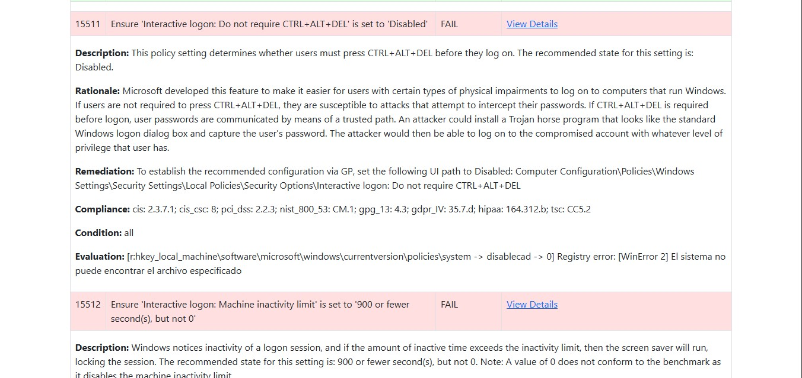

# WinSecureAuditor - CIS Windows Security Scanner
---

WinSecureAuditor is a rule-based Windows security configuration assessment tool using CIS-derived policies. It generates per-rule reports to help administrators review settings; results require verification against the applicable benchmark and do not constitute certification.

The tool performs automated checks against CIS-derived security settings, including registry configurations, file presence, and system policies. The bundled rule profiles cover Windows 10 Enterprise and Windows Server 2012 R2, 2016, and 2019, plus a general Windows audit set. Validate the target edition and build against the rule evidence before interpreting results.

## Key Benefits

- **Rule-Based Assessment**: Loads the bundled Windows profiles and reports per-rule results with remediation guidance
- **Comprehensive Reporting**: Generates HTML and JSON reports with remediation guidance
- **Multi-Interface Support**: Available as both command-line tool and graphical application
- **Extensible Architecture**: Rule-based system allows for custom security checks
- **Professional Security Tool**: Designed for IT administrators, compliance officers, and security teams

## What Makes It Effective

WinSecureAuditor addresses critical security assessment needs by:
- Including CIS-derived Windows rule sets; record the applicable benchmark revision and Windows edition for each assessment (see [CIS Benchmark scope](docs/cis-benchmark-scope.md))
- Providing clear pass/fail results with detailed explanations
- Offering weighted scoring based on security severity
- Enabling both automated scanning and manual verification workflows
- Maintaining compatibility with enterprise security policies

The tool can support reviews of Windows settings against the included profiles; it does not replace a verified benchmark assessment or independent review.

## Overview

A Python-based **Security Configuration Assessment (SCA)** tool for Microsoft Windows. It parses `.yml` rule files (with `policy`, `requirements`, and `checks`), executes registry or file-based checks, and generates HTML/JSON reports with per-rule results and associated metadata.

## Screenshots

### WinSecureAuditor Interface

*Main interface of the WinSecureAuditor tool showing the scanning options and configuration.*

### HTML Report

*Example of the generated HTML report displaying compliance results, pass/fail counts, and detailed rule information.*

### Vulnerability Description

*Detailed view of vulnerability descriptions and remediation guidance in the report.*

## Key Features

- **Registry Checks**: Reads Windows registry keys/values to validate system settings.  
- **File Checks**: Checks existence or presence of critical files.  
- **Rule-Based**: Loads multiple `.yml` files from a directory; each file can contain many checks.  
- **Detailed Reports**: Outputs a color-coded HTML report and a structured JSON report, including:
  - **Description**, **Rationale**, **Remediation**, **Compliance**, **Condition** for each rule
  - **Pass/Fail** counts and a **score percentage**  
- **CLI Flags**: Easily specify your **rules** directory, **JSON/HTML** output paths, **host/OS** overrides, and an optional **benchmark** name.

## Prerequisites

1. **Python 3.7+**  
2. `pip install pyyaml` (for YAML parsing)  
3. **Windows OS** (if you plan to run registry checks). On non-Windows systems, registry checks will fail.

## Usage

### Source Code Version
1. **Clone or Copy** the `WinSecureAuditor` folder onto your Windows machine.
2. **Open** a terminal or Command Prompt in that folder.
3. **Install** dependencies:
   `pip install pyyaml`
4. **Run** the scanner:
   `python main.py --rules=./rules/windows --json=./output/scan.json --html=./output/report.html`
   - `--rules`: Directory containing `.yml` files (with checks).
   - `--json`: JSON output path (default `./output/scan.json`).
   - `--html`: HTML output path (default `./output/report.html`).

### Portable Version
For users who prefer not to install Python or dependencies:

1. **Run** the `WinSecureAuditor_Installer.exe` (located in the project root) as administrator to install the application.
2. **Launch** WinSecureAuditor from the Start Menu or desktop shortcut.

**Alternative Portable Usage:**
- Extract the `WinSecureAuditor_Portable` folder to any location.
- Run `run.bat` as administrator to start the graphical interface.
- Or execute `WinSecureAuditor_GUI.exe` directly.

**Important Notes:**
- Administrator privileges are required for complete scanning.
- Reports are generated in the `output/` directory within the application folder.
- The portable version includes all necessary files and dependencies.

## Output

- **JSON**: A file (e.g. `report.json`) with a structured summary

- **HTML**A color-coded report (e.g. `report.html`) with pass/fail counts, an optional benchmark name, and collapsible rule details for each check.

---

## Known Limitations

**Administrator Privileges**  
Some registry checks require elevated privileges.

**Registry-Only Checks**  
Linux or macOS usage is limited; the registry logic won’t work off Windows.

**File Permissions**  
Currently checks only existence (or “missing”). For advanced checks (permissions, ownership), you’d need further enhancements.

---

**CIS-Scanner Audit Tool** is in an early stage of development.  
The findings generated by this tool should be **manually verified** before taking any action.  
 **Do not use this tool directly in a production environment without thorough testing.**

---
##  License

This project is licensed under the terms of the **GNU General Public License v3.0 (GPL-3.0)**.  
You may use, modify, and distribute this software in compliance with the license terms.

See the [LICENSE](./LICENSE) file for full license details.

## CIS Benchmark scope

See [docs/cis-benchmark-scope.md](docs/cis-benchmark-scope.md).
